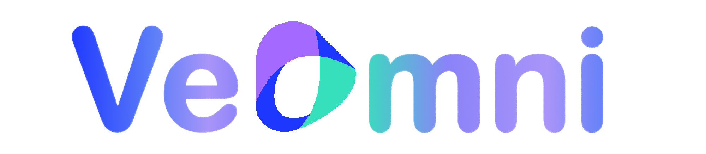
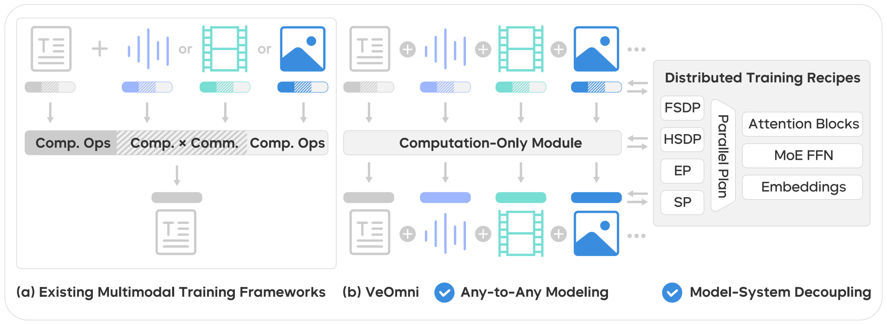
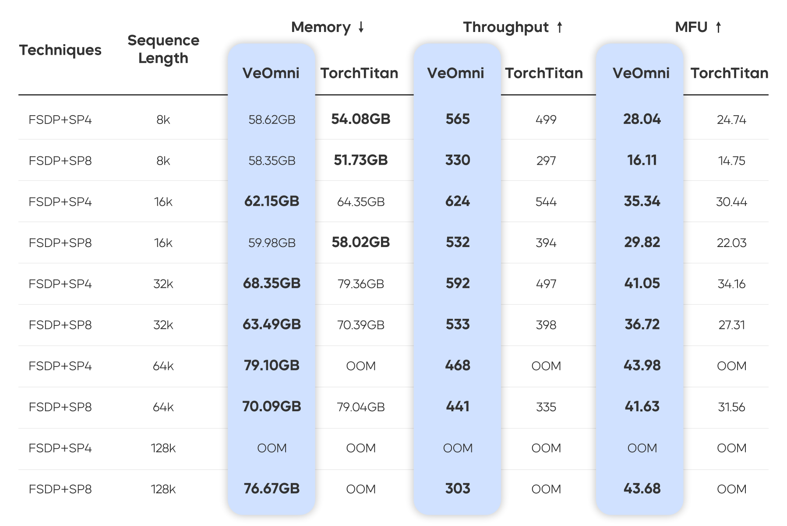

<div align="center">



<div align="center">
    VeOmni: Scaling Any Modality Model Training with Model-Centric Distributed Recipe Zoo
    <br>
    <br>
</div>

[](https://github.com/ByteDance-Seed/VeOmni/stargazers)
[](https://arxiv.org/abs/2508.02317)
[](https://veomni.readthedocs.io/en/latest/)
[](https://raw.githubusercontent.com/ByteDance-Seed/VeOmni/refs/heads/main/docs/assets/wechat.png)

</div>

## 🍪 Overview
VeOmni is a versatile framework for both single- and multi-modal pre-training and post-training. It empowers users to seamlessly scale models of any modality across various accelerators, offering both flexibility and user-friendliness.

Our guiding principles when building VeOmni are:
- **Flexibility and Modularity**: VeOmni is built with a modular design, allowing users to decouple most components and replace them with their own implementations as needed.
- **Trainer-free**: VeOmni supports linear training scripts that avoid rigid, structured trainer classes (e.g., [PyTorch-Lightning](https://github.com/Lightning-AI/pytorch-lightning) or [HuggingFace](https://huggingface.co/docs/transformers/v4.50.0/en/main_classes/trainer#transformers.Trainer) Trainer). These training scripts expose the entire training logic to users for maximum transparency and control. Besides, VeOmni supports a basic trainer for text-only or vlm/omni models training and a rl trainer as a trainer backend in reinforcement learning.

- **Omni model native**: VeOmni enables users to effortlessly scale any omni-model across devices and accelerators.
- **Torch native**: VeOmni is designed to leverage PyTorch’s native functions to the fullest extent, ensuring maximum compatibility and performance.

<div align="center">

</div>

## 🔥 Latest News
- [2025/11] Our Paper [OmniScale: Scaling Any Modality Model Training with Model-Centric Distributed Recipe Zoo](https://arxiv.org/abs/2508.02317) was accepted by AAAI 2026
- [2025/09] We released VeOmni's first official version, [v0.1.0](https://github.com/ByteDance-Seed/VeOmni/pull/75).
- [2025/08] We release [VeOmni Tech report](https://arxiv.org/abs/2508.02317) and open the [WeChat group](./docs/assets/wechat.png). Feel free to join us!
- [2025/04] We release VeOmni!


## 📚 Key Features
- **FSDP2** backend for training.
- **Sequence Parallelism** with [Deepspeed Ulysess](https://arxiv.org/abs/2309.14509), support with non-async and async mode.
- **Experts Parallelism** support large MOE model training, like [Qwen3-Moe](https://veomni.readthedocs.io/en/latest/key_features/ep_fsdp2.html).
- Efficient **GroupGemm** kernel for Moe model, [Liger-Kernel](https://github.com/linkedin/Liger-Kernel).
- Compatible with HuggingFace Transformers models. [Qwen3](https://veomni.readthedocs.io/en/latest/examples/qwen3.html), [Qwen3-VL](https://veomni.readthedocs.io/en/latest/examples/qwen3_vl.html), Qwen3-Moe, etc
- Dynamic batching strategy, Omnidata processing
- [**Torch Distributed Checkpoint**](https://docs.pytorch.org/docs/stable/distributed.checkpoint.html) for checkpoint.
- Support for NVIDIA GPU, AMD ROCm, Ascend NPU, and Cambricon MLU training.
- Experiment tracking with wandb

## 📝 Upcoming Features and Changes

- VeOmni v0.2 Roadmap https://github.com/ByteDance-Seed/VeOmni/issues/268, https://github.com/ByteDance-Seed/VeOmni/issues/271
- Vit balance tool https://github.com/ByteDance-Seed/VeOmni/issues/280
- Validation dataset during training https://github.com/ByteDance-Seed/VeOmni/issues/247
- RL post training for omni-modality models with VeRL https://github.com/ByteDance-Seed/VeOmni/issues/262


## 🚀 Getting Started

<a href="https://veomni.readthedocs.io/en/latest/index.html"><b>Documentation</b></a>

### Quick Start
  - [Installation](https://veomni.readthedocs.io/en/latest/get_started/installation/install.html)
  - [Quick Start with Qwen3](https://veomni.readthedocs.io/en/latest/examples/qwen3.html)


## ✏️ Supported Models

> **Legend:** `✅` Verified · `—` Unverified · `❌` Unsupported
>
> [Eight-device training results](docs/examples/eight_device_validation.md) identify the checkpoint, training method and tested inputs for each run.
>
> **Hardware Guides:** [NVIDIA GPU](docs/get_started/installation/install.md) · [Ascend NPU](docs/hardware_support/get_started_npu.md) · [AMD ROCm](docs/hardware_support/rocm/README.md) · [Cambricon MLU](docs/hardware_support/mlu/README.md)

| Model | NVIDIA GPU | Ascend NPU | AMD GPU | Cambricon MLU | Example Config / Guide |
| :--- | :---: | :---: | :---: | :---: | :--- |
| [BAGEL](https://huggingface.co/ByteDance-Seed/BAGEL-7B-MoT) | ✅ | — | — | — | [base.yaml](configs/seed_omni/Bagel/bagel_7b_mot/train/base.yaml) · [Guide](docs/seed_omni/models/bagel.md) |
| [Cosmos3-Nano](https://huggingface.co/nvidia/Cosmos3-Nano) | ✅ | — | — | — | [online.yaml](configs/seed_omni/Cosmos3/cosmos3_nano/train/online.yaml) · [Guide](docs/seed_omni/models/cosmos3.md) |
| [DeepSeek-V2.5 / V3 / R1](https://huggingface.co/deepseek-ai) | ✅ | ✅ | ✅ | — | [deepseek.yaml](configs/text/deepseek.yaml) |
| [DeepSeek-V4](https://huggingface.co/deepseek-ai) | ✅ | ✅ | ✅ | — | [deepseek_v4.yaml](configs/text/deepseek_v4.yaml) · [NPU](configs/text/deepseek_v4_npu.yaml) |
| [Gemma 3](https://huggingface.co/google) | ✅ | — | — | — | [gemma3.yaml](configs/text/gemma3.yaml) |
| [GLM-5 (`glm_moe_dsa`)](https://huggingface.co/zai-org) | ✅ | — | — | — | — |
| [GPT-OSS](https://huggingface.co/openai/gpt-oss-120b) | ✅ | ❌ | ❌ | ❌ | [gpt_oss_120b_lora_ep4.yaml](configs/text/gpt_oss_120b_lora_ep4.yaml) |
| [HunyuanVideo 1.5](https://huggingface.co/tencent/HunyuanVideo-1.5) | ✅ | ✅ | — | — | [hunyuanvideo15_t2v.yaml](configs/dit/hunyuanvideo15_t2v.yaml) · [Guide](docs/examples/hunyuanvideo15.md) |
| [Janus](https://huggingface.co/deepseek-ai/Janus-1.3B) | ✅ | — | — | — | [base.yaml](configs/seed_omni/Janus/janus/train/base.yaml) · [Guide](docs/seed_omni/models/janus.md) |
| [Llama 3 / 3.1 / 3.3](https://huggingface.co/meta-llama) | ✅ · [8-device results](docs/examples/eight_device_validation.md) | ✅ · [8-device results](docs/examples/eight_device_validation.md) | ✅ | ✅ | [llama3.yaml](configs/text/llama3.yaml) |
| [LTX-2.3](https://huggingface.co/Lightricks/LTX-2.3) | ✅ | ✅ | — | — | [ltx2_av_lora.yaml](configs/dit/ltx2_av_lora.yaml) · [Guide](docs/examples/ltx-2.3.md) |
| [MiniMax-H3](https://huggingface.co/MiniMaxAI) | ✅ | ✅ | — | — | [FL2VA](configs/dit/minimax_h3_fl2va_offline.yaml) · [Ref2VA](configs/dit/minimax_h3_ref2va_cfg_offline.yaml) · [Guide](docs/examples/minimax_h3.md) |
| [Qwen2 / Qwen2.5](https://huggingface.co/Qwen) | ✅ · [8-device results](docs/examples/eight_device_validation.md) | ✅ · [8-device results](docs/examples/eight_device_validation.md) | ✅ | — | [qwen2_5.yaml](configs/text/qwen2_5.yaml) |
| [Qwen2-VL / Qwen2.5-VL](https://huggingface.co/Qwen) | ✅ · [8-device results](docs/examples/eight_device_validation.md) | ✅ · [8-device results](docs/examples/eight_device_validation.md) | ✅ | — | [qwen2_vl.yaml](configs/multimodal/qwen2_vl/qwen2_vl.yaml) · [qwen25_vl.yaml](configs/multimodal/qwen25_vl/qwen25_vl.yaml) |
| [Qwen2.5-Omni](https://huggingface.co/Qwen) | ✅ | ✅ | ✅ | — | [qwen25_omni.yaml](configs/multimodal/qwen25_omni/qwen25_omni.yaml) |
| [Qwen3](https://huggingface.co/Qwen) | [✅ 8× H20](configs/models/qwen3/cuda.yaml) | [✅ 8× 910B2](configs/models/qwen3/ascend.yaml) | ✅ | ✅ | [Training guide](docs/examples/qwen3.md) |
| [Qwen3-MoE](https://huggingface.co/Qwen) | [✅ 8× H20](configs/models/qwen3_moe/cuda.yaml) | [✅ 8× 910B2](configs/models/qwen3_moe/ascend.yaml) | ✅ | ✅ | [qwen3-moe.yaml](configs/text/qwen3-moe.yaml) · [Guide](docs/examples/qwen3_moe.md) |
| [Qwen3-VL](https://huggingface.co/Qwen) | [✅ 8× H20](configs/models/qwen3_vl/cuda.yaml) | [✅ 8× 910B2](configs/models/qwen3_vl/ascend.yaml) | ✅ | ✅ | [Training guide](docs/examples/qwen3_vl.md) |
| [Qwen3-VL-MoE](https://huggingface.co/Qwen) | ✅ | [✅ 8× 910B2](configs/models/qwen3_vl_moe/ascend.yaml) | ✅ | ✅ | [qwen3_vl_moe.yaml](configs/multimodal/qwen3_vl/qwen3_vl_moe.yaml) |
| [Qwen3-Omni-MoE](https://huggingface.co/Qwen) | [✅ 8× H20](configs/models/qwen3_omni_moe/cuda.yaml) | [✅ 8× 910B2](configs/models/qwen3_omni_moe/ascend.yaml) | ✅ | — | [qwen3_omni.yaml](configs/multimodal/qwen3_omni/qwen3_omni.yaml) · [Guide](docs/examples/qwen3_omni_moe.md) |
| [Qwen3.5](https://huggingface.co/Qwen) | [✅ 8× H20](configs/models/qwen3_5/cuda.yaml) | ✅ | ✅ | ✅ | [qwen3_5_vl.yaml](configs/multimodal/qwen3_5/qwen3_5_vl.yaml) · [Guide](docs/examples/qwen3_5.md) |
| [Qwen3.5-MoE](https://huggingface.co/Qwen) | [✅ 8× H20](configs/models/qwen3_5_moe/cuda.yaml) | ✅ | ✅ | ✅ | [qwen3_5_moe_vl.yaml](configs/multimodal/qwen3_5_moe/qwen3_5_moe_vl.yaml) · [Guide](docs/examples/qwen3_5.md) |
| [Qwen3.8-Flash-Next (`qwen4_exp`)](https://huggingface.co/Qwen) | ✅ | ✅ | — | — | [qwen4exp.yaml](configs/text/qwen4exp.yaml) · [Guide](docs/examples/qwen4_exp_frozen_ple.md) |
| [Qwen-Image / Qwen-Image-Edit](https://huggingface.co/Qwen) | ✅ | ✅ | ✅ | ✅ | [qwen_image_sft.yaml](configs/dit/qwen_image_sft.yaml) · [Edit](configs/dit/qwen_image_edit_2511.yaml) · [Guide](docs/examples/qwen_image_edit.md) |
| [Seed-OSS](https://huggingface.co/ByteDance-Seed) | ✅ | [✅ 8× 910B2](configs/models/seed_oss/ascend.yaml) | — | — | [seed_oss.yaml](configs/text/seed_oss.yaml) · [Guide](docs/examples/seed_oss.md) |
| [Wan2.1 / Wan2.2](https://huggingface.co/Wan-AI) | ✅ | ✅ | ✅ | ✅ | [wan_sft.yaml](configs/dit/wan_sft.yaml) · [Wan2.2](configs/dit/wan2.2_I2V_14B.yaml) · [Guide](docs/examples/wan2.1.md) |

For inference-only models, see [MiniMax-H3-Image](docs/examples/minimax_h3_image.md).

Support new models to VeOmni see [Support New Models](https://veomni.readthedocs.io/en/latest/usage/support_new_models/guide_and_checklist.html)

## ⛰️ Performance

<div align="left">

</div>

For more details, please refer to our [paper](https://arxiv.org/abs/2508.02317).

## 💡 Awesome work using VeOmni
- [dFactory: Easy and Efficient dLLM Fine-Tuning](https://github.com/inclusionAI/dFactory)
- [LMMs-Engine](https://github.com/EvolvingLMMs-Lab/lmms-engine)
- [UI-TARS: Pioneering Automated GUI Interaction with Native Agents](https://github.com/bytedance/UI-TARS)
- [OpenHA: A Series of Open-Source Hierarchical
Agentic Models in Minecraft](https://arxiv.org/pdf/2509.13347)
- [UI-TARS-2 Technical Report: Advancing GUI Agent with Multi-Turn Reinforcement Learning](https://arxiv.org/abs/2509.02544)
- [Open-dLLM: Open Diffusion Large Language Models](https://github.com/pengzhangzhi/Open-dLLM)
- [LingBot-VLA: A Pragmatic VLA Foundation Model](https://github.com/Robbyant/lingbot-vla)

## 🎨 Contributing

Contributions from the community are welcome! Please check out [CONTRIBUTING.md](CONTRIBUTING.md) our project roadmap(To be updated),


## 📝 Citation and Acknowledgement

If you find VeOmni useful for your research and applications, feel free to give us a star ⭐ or cite us using:

```bibtex
@article{ma2025veomni,
  title={VeOmni: Scaling Any Modality Model Training with Model-Centric Distributed Recipe Zoo},
  author={Ma, Qianli and Zheng, Yaowei and Shi, Zhelun and Zhao, Zhongkai and Jia, Bin and Huang, Ziyue and Lin, Zhiqi and Li, Youjie and Yang, Jiacheng and Peng, Yanghua and others},
  journal={arXiv preprint arXiv:2508.02317},
  year={2025}
}
```

Thanks to the following projects for their excellent work:

- [ByteCheckpoint](https://arxiv.org/abs/2407.20143)
- [veScale](https://github.com/volcengine/veScale)
- [Liger-Kernel](https://github.com/linkedin/Liger-Kernel)
- [LLaMA-Factory](https://github.com/hiyouga/LLaMA-Factory)
- [torchtitan](https://github.com/pytorch/torchtitan/)
- [torchtune](https://github.com/pytorch/torchtune)

## Star History

[](https://www.star-history.com/#ByteDance-Seed/VeOmni&type=date&legend=top-left)


## 🌱 About [ByteDance Seed Team](https://team.doubao.com/)

<div align="center">

</div>

Founded in 2023, ByteDance Seed Team is dedicated to crafting the industry's most advanced AI foundation models. The team aspires to become a world-class research team and make significant contributions to the advancement of science and society. You can get to know Bytedance Seed better through the following channels👇
<div>
  <a href="https://team.doubao.com/">
    </a>
  <a href="https://github.com/user-attachments/assets/469535a8-42f2-4797-acdf-4f7a1d4a0c3e">
    </a>
 <a href="https://www.xiaohongshu.com/user/profile/668e7e15000000000303157d?xsec_token=ABl2-aqekpytY6A8TuxjrwnZskU-6BsMRE_ufQQaSAvjc%3D&xsec_source=pc_search">
    </a>
  <a href="https://www.zhihu.com/org/dou-bao-da-mo-xing-tuan-dui/">
    </a>

</div>
