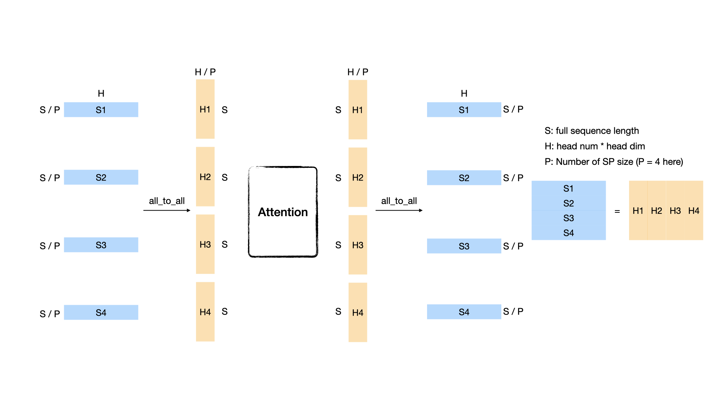
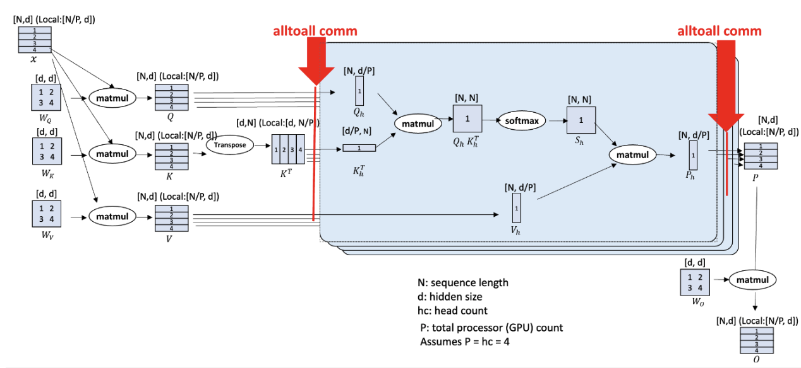
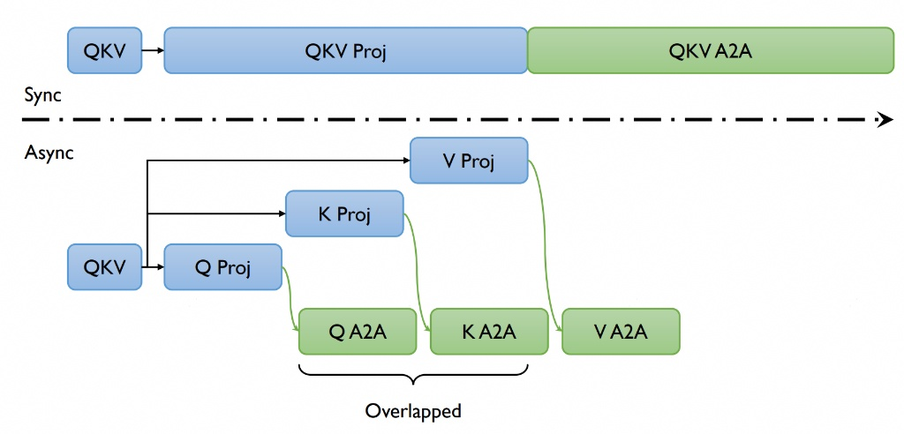

# Long-Sequence Training Using Ulysses

## 📚 Overview
In this tutorial, we introduce the implementation of DeepSpeed-Ulysses for efficient long-sequence training in VeOmni. The Ulysses method optimizes memory usage by splitting both the input tensor and intermediate activations along the sequence dimension. This innovative approach significantly enhances memory efficiency, enabling the training of models with longer sequence lengths.

Reference Paper: [DeepSpeed Ulysses: System Optimizations for Enabling Training of Extreme Long Sequence Transformer Models](https://arxiv.org/abs/2309.14509)

## 🚀 Quick Start
To enable Ulysses, users can specify the `accelerator.ulysses_size` parameter in the configuration file or the launch command:

```shell
bash train.sh tasks/train_vlm.py configs/multimodal/qwen25_vl/qwen25_vl.yaml \
    --model.model_path YOUR_MODEL_PATH \
    --data.train_path YOUR_DATA_PATH \
    --model.accelerator.ulysses_size 4
```

VeOmni currently supports Ulysses on the following models:

Language models:
- LLaMA
- Qwen2.5
- Qwen3.5 (hybrid softmax + linear attention, requires transformers v5)

Multimodal models:
- Qwen2-VL
- Qwen2.5-VL

## 🔍 Dive into Ulysses Sequence Parallelism
Sequence Parallel (SP) is a common strategy for handling sequences that exceed the memory limit of a single GPU. Ulysses uses all-to-all collective communication operations to implement SP for attention.

### What is all_to_all?

Suppose we have P GPUs and a sequence whose shape is [S, H], where S denotes the sequence length and H represents the hidden size (number of heads \* head dimension). Each GPU initially holds an [S/P, H] partition. After an all_to_all operation, each GPU holds a head-partitioned sequence whose shape is [S, H/P]. The following figure illustrates the case where P = 4:



### DeepSpeed-Ulysses
We use the all-to-all-based sequence parallelism proposed by DeepSpeed, named DeepSpeed-Ulysses.



(Image source: [DeepSpeed Ulysses: System Optimizations for Enabling Training of Extreme Long Sequence Transformer Models](https://arxiv.org/abs/2309.14509))

The figure above shows the overall architecture of DeepSpeed-Ulysses. It introduces only two additional all_to_all communications in the attention module and does not modify other components such as normalization and MLP. The input sequence is first divided evenly across the GPUs. The first all_to_all communication gathers the query, key, and value ([S/P, H]) along the sequence dimension and scatters them along the head dimension ([S, H/P]). After attention, another all_to_all transfers the output ([S, H/P]) from head-partitioned form back to sequence-partitioned form ([S/P, H]). DeepSpeed-Ulysses is attention-agnostic because it gathers the entire sequence during attention computation, so it can be used with FlashAttention. However, the number of query heads must be divisible by the Ulysses parallel size; grouped-query attention has additional key/value head constraints. DeepSpeed-Ulysses does not affect memory consumed by model states. For long-sequence training with a large language model, it can be combined with ZeRO or FSDP.

### Communication Analysis
The communication volume transmitted per link for an all-to-all operation with an aggregate message of size M over P GPUs can be estimated as $M(P-1)/P^2$. For a transformer model with hidden size H, sequence length S, and parallelism degree P, let $\mu = (P-1)/P$. Before attention, DeepSpeed-Ulysses performs an all-to-all for the QKV projections with an aggregate message size of $3SH$, introducing a communication volume of $3SH\mu/P$. Each transformer layer performs another all-to-all for the output context projection with an aggregate message size of $SH$, introducing $SH\mu/P$. Therefore, DeepSpeed sequence parallelism incurs an aggregate communication volume per link of $4SH\mu/P = 4M(P-1)/P^2$.

## ⚙️ Core API

1. gather_seq_scatter_heads

A method to do all-to-all before attention, make sure the sequence is full for attention score computation.

```Python
def gather_seq_scatter_heads(
    x: torch.Tensor,
    seq_dim: int,
    head_dim: int,
    unpadded_dim_size: int = 0,
    async_op: bool = False,
) -> Tensor
```

Args:
- x: tensor to be synced
- seq_dim: sequence dim that will be gathered
- head_dim: head dim that will be scattered. "head" is a concept from Multi-head Attention or Group Query Attention
- unpadded_dim_size: the full sequence size before padding and sharding
- async_op: if True, will return a torch._C._distributed_c10d.Work object, users can use this arg to do comm-compute overlap

2. gather_heads_scatter_seq

A method to do all-to-all after attention, transforming the activation from head-split to sequence-split.

```Python
def gather_heads_scatter_seq(
    x: torch.Tensor,
    head_dim: int,
    seq_dim: int
) -> Tensor
```

Args:
- x: Tensor to be synced
- head_dim: head dim that will be gathered
- seq_dim: sequence dim that will be scattered


3. reduce_sequence_parallel_loss

A method to reduce loss within the sequence parallel group, re-scale the loss according to the number of valid tokens.

```Python
def reduce_sequence_parallel_loss(
    loss: torch.Tensor,
    num_valid_tokens: torch.Tensor
) -> torch.Tensor
```

Args:
- loss: loss tensor to be reduced
- num_valid_tokens: the number of valid tokens in current rank

## 🛠️ Support Ulysses for a New Model

Typically, enabling Ulysses for a new model involves three key steps:

1. Create a sequence parallel group based on the specified Ulysses parallel size.
2. Shard input sequences across the sequence parallel groups.
3. Modify the model’s attention and loss computation to support Ulysses.

In VeOmni, the first two steps are automated. Users only need to specify the `accelerator.ulysses_size` parameter, and VeOmni will handle the creation of sequence parallel groups and the sharding of input data. This allows users to focus solely on step 3—modifying the model’s architecture to implement Ulysses sequence parallelism.

To make this process easier, we provide an abstract pseudo-code example as a reference for implementing Ulysses in a new model:

```Python
from veomni.distributed.sequence_parallel import (
    gather_seq_scatter_heads_qkv,
    gather_heads_scatter_seq,
    reduce_sequence_parallel_loss,
)
# Step1: Create a sequence parallel group
# VeOmni will construct a sequence parallel group based on the parallel size

# Step2: Shard input sequences
# Suppose we get an input x of shape [batch_size, seq_len, dim]
# we first shard x among sequence parallel groups
# now x is of shape [batch_size, seq_len/n, dim] on each sp rank

# Step3 (part1): modify attention computation
x = self.qkv(x) # [batch_size, seq_pad/n, dim]
x = gather_seq_scatter_heads(x, seq_dim=1, head_dim=2) # [batch_size, seq_len, dim/n]
...
output = F.scaled_dot_product_attention(q, k, v, ...).reshape(...)
...
output = gather_heads_scatter_seq(output, head_dim=2, seq_dim=1) # [batch_size, seq_pad/n, dim]

# Step3 (part2): reduce loss after model forward
loss = loss_fct(logits, labels)
loss = reduce_sequence_parallel_loss(loss, num_valid_tokens)
return loss
```

## 🧩 Implementation Details: Data Pipeline and Model Interaction

Understanding how sequence parallelism data flows through the VeOmni pipeline is critical for
adding SP support to new models and for debugging shape mismatches. This section documents the
full lifecycle of tensors from the data collator to the model forward pass.

### Data Collator: `SequenceParallelCollator`

When SP is enabled, `MainCollator` appends a `SequenceParallelCollator` to its pipeline
(see `veomni/data/data_collator.py`). This collator handles three operations in order:

1. **Label shifting** — shifts `labels` left by 1 token (for next-token prediction).
2. **SP padding and slicing** — for each key in the batch:
   - **Pad** the sequence to be evenly divisible by `sp_size` (using `sp_pad_value` from `DataCollateInfo`).
   - **Slice** the sequence for the current SP rank (`tensor.narrow(dim, rank * chunk, chunk)`).
3. **Flash attention kwargs** — computed from `position_ids` *before* slicing it.

The default `DataCollateInfo` for each key:

| Key | `sp_slice` | `sp_pad_value` | Notes |
|-----|-----------|----------------|-------|
| `input_ids` | True | 0 | Sliced to local length |
| `labels` | True | -100 | Sliced to local length |
| `attention_mask` | False | 1 | Padded but NOT sliced (always all-ones for FA) |
| `position_ids` | False | 0 | Sliced **after** FA kwargs are computed from it |

**Key ordering detail:** `position_ids` is intentionally excluded from the general slicing loop.
It is first used at full length to compute `cu_seq_lens_q/k` via `add_flash_attention_kwargs_from_position_ids`,
then sliced afterward. This ensures the FA kwargs describe the full packed sequence boundaries, which
is needed by the flash attention kernel after the Ulysses all-to-all gathers the full sequence.

After the collator, the model receives:

| Tensor | Sequence length | Description |
|--------|----------------|-------------|
| `input_ids` | `S / sp_size` | Local token IDs |
| `labels` | `S / sp_size` | Local shifted labels |
| `position_ids` | `S / sp_size` | Local positions (correct absolute values) |
| `attention_mask` | `S` | Full-length all-ones mask |
| `cu_seq_lens_q` | varies | Computed from full `position_ids` before slicing |

### Softmax Attention (Flash Attention) SP Flow

For standard softmax attention layers (e.g., `Qwen3_5Attention`), Ulysses SP is handled
**internally** by `flash_attention_forward` in
`veomni/ops/kernels/attention/standard/flash.py`.

The flow through a softmax attention layer:

```
hidden_states [B, S_local, D]           # already local from collator
  -> QKV projection                      # [B, S_local, num_heads, head_dim]
  -> apply_rotary_pos_emb(q, k, cos, sin)  # RoPE on local-length q/k
  -> flash_attention_forward:
       gather_seq_scatter_heads(q,k,v)   # [B, S_full, local_heads, head_dim]
       flash_attention_op(...)       # attention on full sequence, local heads
       gather_heads_scatter_seq(output)  # [B, S_local, num_heads, head_dim]
  -> output projection                   # [B, S_local, D]
```

**Important:** Position embeddings (`cos`, `sin`) must match `hidden_states` length (`S_local`).
Since `position_ids` is already sliced by the collator, `rotary_emb(hidden_states, position_ids)`
produces local-length position embeddings — no additional slicing is needed.

> **Note on Qwen3/Qwen3-MoE:** These models use LigerKernel's `apply_rotary_pos_emb` which tolerates
> mismatched sequence lengths between q/k and cos/sin. Qwen3.5 uses the standard HuggingFace
> implementation, which requires exact size match. When adding SP to a new model, always check
> which RoPE implementation is active.

### Loss Reduction

When SP is enabled, each rank computes loss on its local sequence shard. The loss must be
reduced across the SP group, re-scaled by the number of valid (non-padding) tokens per rank.
This is handled by `reduce_sequence_parallel_loss` or by the fused loss in the model's forward
method. See the Core API section above for details.

---

## 🔧 Linear Attention Ulysses (GatedDeltaNet)

Hybrid models like Qwen3.5 alternate between softmax attention layers and linear attention
layers (GatedDeltaNet). While softmax attention SP is handled transparently by
`flash_attention_forward`, linear attention layers require **explicit Ulysses SP logic** in
their forward method because they use a different attention mechanism (recurrence-based, not
score-based) with additional components like causal conv1d.

### Why Linear Attention Needs Special Handling

1. **No shared flash attention path** — GatedDeltaNet uses `chunk_gated_delta_rule` from FLA, not flash attention.
2. **Causal conv1d** — operates along the sequence dimension. Each rank only has a local sequence shard, so the conv1d must run on the full sequence with appropriately sharded weights.
3. **Per-head parameters** — `A_log` and `dt_bias` are indexed by head, so they need slicing for local heads.

### GatedDeltaNet Ulysses SP Flow

```
hidden_states [B, S_local, D]
  -> QKV + z + b + a projections

  IF ulysses_enabled:
    -> split mixed_qkv into Q, K, V and reshape to [B, S_local, num_heads, head_dim]
    -> gather_seq_scatter_heads(Q, K, V, b, a)   # [B, S_full, local_heads, ...]
    -> flatten heads + concat Q,K,V               # [B, S_full, local_conv_dim]
    -> _get_local_conv1d_weight(rank)             # shard conv1d weights for local heads
    -> causal_conv1d(mixed_qkv, local_weight, cu_seqlens=cu_seq_lens_q)
    -> split and reshape with local head counts
    -> slice A_log, dt_bias for local V-heads
    -> chunk_gated_delta_rule(q, k, v, g, beta, cu_seqlens=cu_seq_lens_q)
    -> gather_heads_scatter_seq(attn_out)         # [B, S_local, num_v_heads, head_v_dim]
    -> gated_norm(attn_out, z)                    # z was NOT all-to-all'd
    -> output projection
  ELSE:
    -> standard (non-SP) forward path
```

### Conv1d Weight Sharding

The conv1d weight has shape `[Q_channels | K_channels | V_channels, kernel_size]`.
Under Ulysses SP, each rank only processes local heads, so the conv1d weight must be
sharded to extract only the channels corresponding to local Q, K, V heads:

```python
def _get_local_conv1d_weight(self, ulysses_rank, local_key_dim, local_value_dim):
    w_full = self.conv1d.weight.squeeze(1)  # [conv_dim, kernel_size]
    k_off = ulysses_rank * local_key_dim
    v_off = ulysses_rank * local_value_dim
    w_q = w_full[k_off : k_off + local_key_dim]
    w_k = w_full[key_dim + k_off : key_dim + k_off + local_key_dim]
    w_v = w_full[2 * key_dim + v_off : 2 * key_dim + v_off + local_value_dim]
    return torch.cat([w_q, w_k, w_v], dim=0)
```

### Key Difference: `z` Is NOT All-to-All'd

The gating signal `z` is used *after* the attention output is gathered back to local
sequence layout (`gather_heads_scatter_seq`). Since `z` starts at `[B, S_local, num_v_heads, head_v_dim]`
and the gathered attention output is also `[B, S_local, num_v_heads, head_v_dim]`, they
match without any all-to-all on `z`. This saves one all-to-all communication.

### `cu_seq_lens_q` Usage

`cu_seq_lens_q` describes the packed sequence boundaries (computed from full `position_ids` before
slicing). After the all-to-all gathers the full sequence, `cu_seq_lens_q` correctly describes the
sequence boundaries for the causal conv1d and chunk attention kernels.

### Head Divisibility Requirement

Both `num_k_heads` and `num_v_heads` must be divisible by `ulysses_size`. For GQA (grouped query
attention) where `num_v_heads > num_k_heads`, the GQA repeat ratio `num_v_heads // num_k_heads`
is preserved after dividing both by `ulysses_size`.

### Testing

Tests for GatedDeltaNet Ulysses SP are in `tests/parallel/ulysses/test_qwen3_5_gated_deltanet_ulysses.py`:

1. **Conv1d weight slicing** — single-GPU, validates that sliced conv1d output matches the
   corresponding slice of full conv1d output.
2. **SP forward/backward equivalence** — multi-GPU, compares SP partitioned outputs and gradients
   against a non-SP baseline.
3. **SP forward determinism** — multi-GPU, verifies repeated forward passes produce identical outputs.
4. **Non-SP forward determinism** — single-GPU, baseline determinism check.

---

## ⚡ Async Ulysses CP

We also support **Async Ulysses** which further improves performance by overlapping communication and computation, reducing communication latency and improving hardware utilization.

### Asynchronous Ulysses



VeOmni extends the original Ulysses implementation with asynchronous communication capabilities, further improving performance by overlapping communication and computation.

#### Performance Benefits

By overlapping communication and computation, Async Ulysses:
- Reduces idle time during communication operations
- Lowers end-to-end training time
- Maintains nearly the same memory efficiency as original Ulysses

#### Enabling Async Ulysses

To enable Async Ulysses, simply set the `accelerator.enable_async` parameter to `True`:

Notice: Async Ulysses works when `accelerator.ulysses_size > 1`.

```shell
bash train.sh tasks/train_vlm.py configs/multimodal/qwen3_vl/qwen3_vl_dense.yaml \
    --model.accelerator.ulysses_size 4 \
    --model.accelerator.enable_async true
```


### API

Async Ulysses is two registered ops. Modeling constructs a local handle and
calls it; there is no public `async_ulysses_qkv_projection` /
`async_ulysses_output_projection` function.

| Op | Variants | Implementation |
|---|---|---|
| `async_ulysses_qkv` | `standard`, `dit` | `eager` |
| `async_ulysses_o` | `standard`, `dit` | `eager` |

`standard` is the transformer path (Qwen3-VL / Qwen3-VL-MoE). `dit` is the
diffusion path (Wan). Nested RMSNorm uses a raw inner pair; LayerNorm still
goes through the fused CUDA helper in `veomni/ops/kernels/async_ulysses/shared/`.

```python
from veomni.ops import VeomniOp

q, k, v = VeomniOp("async_ulysses_qkv", "standard")(
    hidden_states=hidden_states,
    seq_dimension=1,
    head_dimension=2,
    q_weight=self.q_proj.weight,
    q_bias=self.q_proj.bias,
    k_weight=self.k_proj.weight,
    k_bias=self.k_proj.bias,
    v_weight=self.v_proj.weight,
    v_bias=self.v_proj.bias,
    norm_type="rmsnorm",
    norm_q_weight=self.q_norm.weight,
    norm_k_weight=self.k_norm.weight,
    normalized_shape=self.head_dim,
    eps=self.config.rms_norm_eps,
    unpadded_dim_size=unpadded_seq_len * get_ulysses_sequence_parallel_world_size(),
    head_dim=self.head_dim,
)

attn_output = VeomniOp("async_ulysses_o", "standard")(
    hidden_states=attn_output,
    seq_dimension=1,
    head_dimension=2,
    proj_weight=self.o_proj.weight,
    proj_bias=self.o_proj.bias,
    unpadded_dim_size=attn_output.shape[1],
)
```

See `veomni/models/transformers/qwen3_vl/qwen3_vl_gpu_patch_gen_config.py` for
the live transformer consume, and `veomni/models/transformers/wan/modeling_wan.py`
for the `dit` consume. Registry rows live in
`veomni/ops/kernels/async_ulysses/`.

### Enabling Async Ulysses

To enable Async Ulysses for an existing model, you need to:

1. Check that the model consumes `async_ulysses_qkv` / `async_ulysses_o`
2. Set `accelerator.enable_async=True` in your training configuration
3. Keep Ulysses sequence parallelism enabled (`accelerator.ulysses_size > 1`)
4. For the transformer path, use a flash-attention implementation; the async
   consume requires the packed-varlen contract

Async Ulysses is currently consumed by:

- Qwen3-VL
- Qwen3-VL-MoE
- Wan

Support for more models will be added in future releases.

## 🔗 USP: Unified Sequence Parallelism (Ulysses × Ring)

USP combines Ulysses head/sequence all-to-all with Ring-Attention across a
context-parallel group:

```
sp_size = ulysses_size × cp_size
```

Ulysses requires the query-head count to divide evenly across its group.
The shared adapter can repeat KV heads when the Ulysses group exceeds the KV
head count, at the cost of extra memory and communication. Ring adds a sequence
partition that does not depend on the head count. Keep the Ulysses group within
a fast interconnect where possible; benchmark the CP/Ulysses split on the target
hardware rather than selecting it from sequence length alone.

VeOmni uses **zig-zag** block placement for the ring so causal attention stays
load-balanced: the sequence is split into `2·cp_size` blocks and cp-rank `r`
owns blocks `r` and `2·cp_size-1-r`.

### Quick Start

The configuration below uses 32 sequence-parallel ranks; the world size must
be divisible by 32. For one eight-GPU node, override with
`--model.accelerator.ulysses_size 4 --model.accelerator.cp_size 2`.

```shell
bash train.sh tasks/train_text.py configs/text/qwen3_usp.yaml \
    --model.model_path YOUR_MODEL_PATH \
    --data.train_path YOUR_DATA_PATH \
    --model.accelerator.ulysses_size 8 \
    --model.accelerator.cp_size 4          # effective SP size = 32
```

### Constraints

- **Ring path is causal-only**: `cp_size > 1` does not support explicit
  attention masks (only causal). Packed (varlen) sequences ARE supported —
  each document is zig-zag split independently across the `cp` group.
- **Packed divisibility**: under `cp_size > 1`, `PackingCollator` automatically
  pads every packed document to a multiple of `2 · cp_size` before concatenation.
  The inserted tokens use ignored labels (`-100`) and continuing position IDs,
  so they satisfy the zig-zag layout without creating extra varlen boundaries.
  Dynamic batching budgets these aligned physical lengths, and fixed/SP tail
  padding is coalesced into one aligned segment. The lower-level USP reorder
  helpers still validate the invariant and reject manually constructed
  unaligned batches. Dynamic batching selects both its logical and physical
  counters via `get_length_fn_by_count_mode(count_mode, cp_size=..., cp_layout=...)`.
  The explicit topology aligns `total` counts while leaving `effective` counts
  unchanged; callers without topology retain the original counting behavior.
- **Flash-attention backend**: Ring uses the implementation selected by
  `model.ops_implementation.attn_implementation`. FA2 and FA4 are detected
  independently, so installing both does not override an explicit FA4 choice.
  The selected backend is saved for backward; unavailable or incompatible
  primitives are rejected before communication. FA3 is not a Ring backend.
  The example YAML selects FA2. For FA4 (including Blackwell/GB200), add
  `--model.ops_implementation.attn_implementation flash_attention_4` to the command
  above. Blackwell requires separate hardware validation.
  Direct Ring primitive callers can pass `backend="fa2"` or `backend="fa4"`;
  omitting it retains the default of FA2 when installed, otherwise FA4.
- **Divisibility**: `max_seq_len` must be divisible by `2 · ulysses_size · cp_size`
  (the collator pads up to this multiple automatically).
- **Loss/data layout**: the `SequenceParallelCollator` lays sequences out
  cp-outer (zig-zag) / ulysses-inner (contiguous). SFT cross-entropy reduces
  over the SP group by token count, so it is invariant to this reordering. The
  RL/DPO trainers (which gather and re-linearise logits) do not yet support
  `cp_size > 1`.

### Implementation Map

- Ring kernel: `veomni/distributed/sequence_parallel/ring_attention.py`
  (`zigzag_ring_flash_attn_func` for dense, `zigzag_ring_flash_attn_varlen_func`
  for packed, online-softmax `update_out_and_lse`, `RingComm`).
- Data layout: `veomni/distributed/sequence_parallel/data.py`
  (`zigzag_reorder` / `zigzag_undo` for dense, `zigzag_reorder_varlen` /
  `local_cu_seqlens` for packed) and `SequenceParallelCollator._usp_slice`.
- Attention integration: the ring branch in
  `veomni/ops/kernels/attention/standard/flash.py` runs after the Ulysses all-to-all.
- Mesh: `init_parallel_state_from_config()` builds `[cp, ulysses]` and flattens `sp`.

### USP integration with model-specific CP

Set `model.accelerator.cp_layout: zigzag` for USP. The default `contiguous`
layout preserves DeepSeek V4's model-specific CP and does not allow combining
CP with Ulysses. CP cannot be combined with `model.accelerator.enable_async: true`;
async Ulysses and Ring are not integrated yet. USP requires `MODELING_BACKEND=veomni`. This release enables
USP for Qwen3 causal text training with
VeOmni FlashAttention 2 or 4 (`Qwen3ForCausalLM` only). RL/DPO, sequence
classification, multimodal packing, sliding-window attention,
softcap, attention sinks, nonzero attention dropout, and deterministic backward
(`train.enable_full_determinism` / `FLASH_ATTENTION_DETERMINISTIC=1`) are unsupported and
rejected. Other models require a separate compatibility check before enabling USP.

For packed input, the CPU `SequenceParallelCollator` prepares
`usp_cu_seqlens` (CP-local int32 offsets), `usp_max_seqlen` (local maximum
document length), and `usp_half0` / `usp_half1` (int64 gather indices for the
two halves of each local document). These describe the sequence after the
Ulysses gather. The trainer moves tensors with the batch; attention consumes
them without reading device scalars. Custom packed callers must provide the
same metadata, using `prepare_usp_metadata` before moving the batch to the
accelerator. A missing packed metadata set raises before communication.

BF16 Ring changes attention reduction and rounding order. The tests check
dense and packed Ring output/gradient parity, CP=2/4, Ulysses=2 × CP=2, and
tiny Qwen3 packed padding/loss/gradient/SGD parity. Optimizer comparisons use
FP32 master weights so BF16 rounding of small parameter updates does not hide
or amplify the gradient error. These checks do not establish long-run
convergence, cross-node performance, NPU support or Qwen3-VL support.
