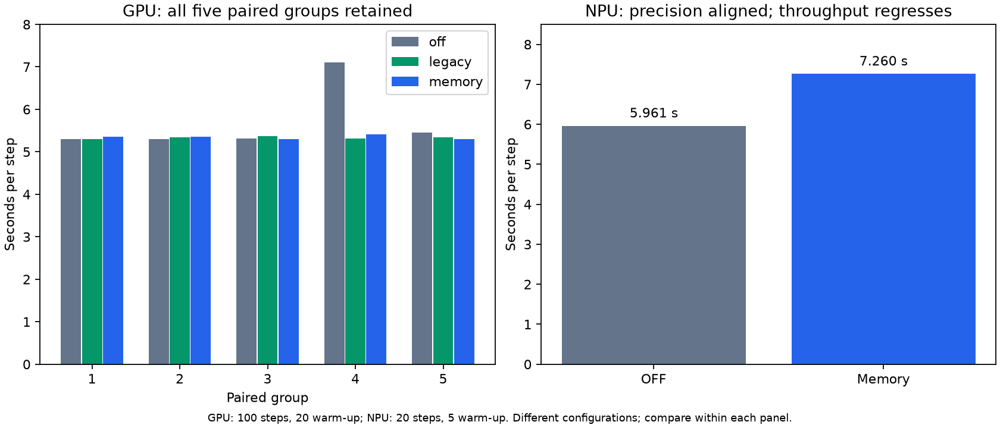
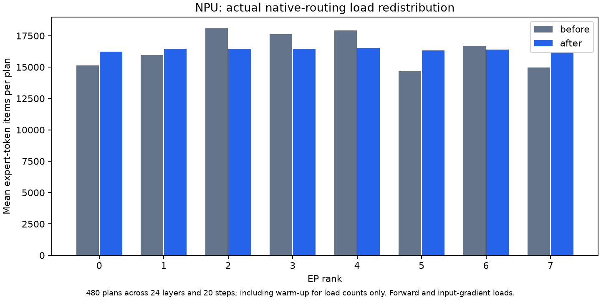

# Qwen3.5-MoE EP validation

Updated: 2026-11-02.

GPU paired measurements show no degradation in observed mean throughput, with
real load balancing and exactly matching loss/gradient-norm curves. Native NPU
execution also preserves precision and redistributes work, but its measured
whole-step throughput regresses. The NPU performance requirement remains open.
The memory path keeps allocated memory close to OFF and below Legacy.

## Scope and provenance

The benchmark uses native routing, BF16, standard AdamW, seed 0, sequence length
2048, global batch 8, hidden size 2048, intermediate size 512, 256 experts and
top-k 8. Activation checkpointing and profiling are disabled for the timing
comparisons. These are reduced-depth prefixes, not full 40-layer results.

| Cohort | Hardware / topology | Training | Evidence revision |
| --- | --- | --- | --- |
| GP04 | Four H20-3e, L8/EP4, accumulation 2 | Five paired groups, three modes, 100 steps each; discard 20 warm-up | Patch `b861bc31…` |
| GP06 | Same GPU configuration | Same 15-run protocol | CUDA optimization patch `59c4040b…` |
| Current NPU | Eight Ascend 910B3, L24/EP8, accumulation 1 | OFF/Memory, 20 steps each; discard 5 warm-up | Native-precision patch `8bcc3ee5…` |

The patch identifiers and software versions are in [the numerical evidence](data/ep_validation.json).
The publication preserves the tested production-file contents; the accompanying
test and offline-reporter corrections account for activation-checkpoint
recomputation in CI and reject nonfinite values in plain logs.
The combined production snapshot has also passed 34 real CUDA kernel/stream
tests. No new 100-step GPU experiment is claimed for the combined snapshot.
Historical GPU timing rows retain their own source identities.

The tested upstream base is `86c5ec1dbba8270206b1ab7f439285215ae4ec92`.
Integration with newer upstream `main` has unresolved merge conflicts, so the
PR remains a draft. This publication retains the tested production tree;
the hardware evidence does not validate future conflict resolutions.

Each window includes the complete training step and uses the maximum elapsed
window across ranks. Global tokens are counted once. Profiling and isolated
kernel timings are excluded. Different platforms have different layer counts
and accumulation; their absolute times must not be compared as a hardware ranking.

## Whole-step throughput and memory

| Cohort / mode | Mean seconds/step | Tokens/s | Throughput vs OFF | Peak allocated GiB |
| --- | ---: | ---: | ---: | ---: |
| GP04 OFF | 5.322727 | 3078.12 | baseline | 39.415 |
| GP04 Legacy | 5.302935 | 3089.61 | +0.373% | 42.310 |
| GP04 Memory | 5.309289 | 3085.91 | **+0.253%** | 39.368 |
| GP06 OFF | 5.693585 | 2877.62 | baseline | 39.415 |
| GP06 Legacy | 5.330590 | 3073.58 | +6.810% | 42.310 |
| GP06 Memory | 5.347487 | 3063.87 | **+6.472%** | 39.368 |
| Current NPU OFF | 5.961189 | 2748.44 | baseline | 50.623 |
| Current NPU Memory | 7.260221 | 2256.68 | **−17.892%** | 50.283 |

The GPU claim is about observed means, not a statistical non-inferiority proof.
GP04's paired 95% step-reduction interval is [−0.641%, +1.137%]. GP06's pooled
+6.472% throughput is strongly influenced by one slow OFF run; its paired
throughput-gain median is only +0.116%, and the paired step-reduction interval
is [−9.978%, +18.679%]. All five groups are retained. A repeatable 5% gain has
not been established. Non-degradation is the required criterion; 5% is an
optimization goal, not a new acceptance threshold.

The NPU figures are one short matched pair, not repeated formal performance
acceptance. A preceding four-mode qualification on the same production patch
also failed the performance gate: OFF 6.634920 / 6.211011, Memory 8.145908 and
Legacy 6.646638 seconds/step. Its allocated peaks were 50.624–50.626, 50.283 and
54.772 GiB respectively. Separate cohorts are not used as a source-code A/B
speedup calculation. Memory reduces the Legacy allocation overhead without
establishing a speed benefit.

## Precision and actual balancing

All 100-step GPU loss/gradient-norm curves match OFF exactly across all ranks.
The current NPU 20-step curves also match exactly. The acceptance envelope
remains `abs(error) <= 1e-4 + 1e-3 * abs(reference)`; it was not relaxed.
Current native EP2 validation covers a small case and the full H/I/E/top-k
dimensions with three seeds, including partial migration and owner operand
checks. It compares outputs, input/router gradients and both expert-weight
gradients against native OFF.

Both GPU ON modes perform real moves on every measured step. The NPU plan
capture contains 480 improved plans across 24 layers and 20 steps, 3,549
replicas and 13,181,991 moved expert-token items. The mean per-plan imbalance
falls from **0.393764 to 0.038123**, using
`mean(abs(rank_load / mean(rank_load) - 1))`. The plan capture is diagnostic;
its timing is excluded from throughput evidence. Every EP-global plan is
counted once, not once per sibling rank.

On NPU, the plan balances forward and input-gradient execution. Native weight
gradients are reconstructed on original owners to preserve the OFF reduction
order; the load plot is not proof that every backward operation is balanced.
NPU returns replica X/dY operands, rather than adding independently rounded
partial weight gradients. This preserves precision but adds communication,
reconstruction and ordering costs. Their critical-path contributions remain
under investigation.

## Reproduction and evidence

The [training guide](../examples/qwen3_5.md#qwen35-moe-ep-load-balance-experiments)
contains opt-in and matched OFF/ON command templates. For reproduction, freeze
the same model/data tensors, seed, optimizer, dimensions, topology, checkpointing,
operator choices and software versions. Predeclare run order and warm-up; retain
all windows, full scalar curves, resolved configuration and clean exit receipts.
Require positive moves/replicas and strict load-profile improvement on ON runs.

- [Per-run timings and memory](data/ep_timing.csv), including all GP04/GP06 groups.
- [Per-rank loss and gradient-norm curves](data/ep_curves.csv).
- [NPU per-step/layer/rank loads](data/ep_rank_load.csv).
- [Version, scope and aggregate evidence](data/ep_validation.json).
- [Figure generator](plot_ep_validation.py); requires Matplotlib and reads only
  the adjacent numerical CSV files.

The checked-in evidence deliberately contains numeric results and version
identifiers, without machine addresses, credentials, user-specific paths or raw
debug logs. Kernel/stream tests and CPU tests are distinct from hardware training
evidence. The CI E2E's forced hotspot/two-step fixture is functional evidence,
not a performance benchmark. Physical telemetry includes recomputation forwards
when activation checkpointing is enabled.

## Remaining work and rollback

NPU non-degradation and repeatable GPU gains still require work. Additional
topologies, full-depth training, multi-node execution and production datasets
remain outside this evidence. No cross-platform bitwise claim follows from
different-depth GPU/NPU runs. A process allocator experiment that slowed both
OFF and ON was rejected; it is not part of the implementation or recommended
configuration.

Disable only `train.moe_ep_load_balance.optimize_memory` to return to Legacy.
Disable `train.moe_ep_load_balance.enabled` and set monitoring interval to zero
to return to OFF. Parameters, optimizer state and checkpoint keys are unchanged.
